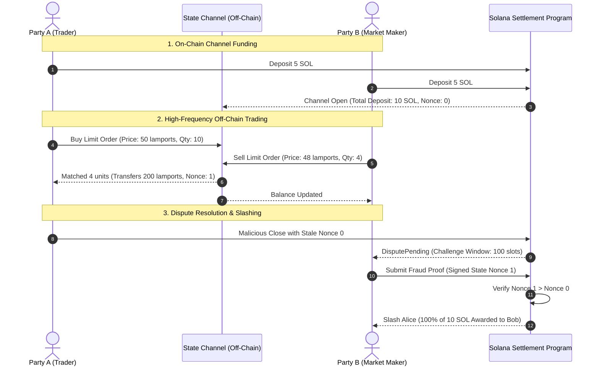

# SolanaVortex

[](https://github.com/ZengLLQ/solana-vortex/actions/workflows/ci.yml)
[](LICENSE)
[](https://www.rust-lang.org)

**SolanaVortex** is a high-throughput off-chain state channel settlement and microsecond limit order book matching engine designed for Solana.

It features bilateral cryptographic state transitions, Hash Time-Locked Contract (HTLC) cross-channel conditional routing, balance conservation invariant guarantees, cooperative zero-latency mutual closes, and on-chain fraud-proof challenge resolution with 100% deposit slashing for stale-state submissions.

---

## Architecture & State Machine



---

## Core Algorithmic Mechanics

### 1. Cryptographic State Hash Commitment

Each off-chain channel update signs an unambiguous 32-byte cryptographic state digest computed via SHA-256:

$$\mathcal{H}_{\text{state}} = \text{SHA-256}\left(\text{ID}_{\text{channel}} \parallel S \parallel B_A \parallel B_B \parallel \bigoplus_{i} \text{HTLC}_i\right)$$

where:
- $\text{ID}_{\text{channel}} = \text{SHA-256}(\text{Pubkey}_A \parallel \text{Pubkey}_B)$
- $S$ is the strictly monotonic sequence nonce ($S_{k+1} > S_k$)
- $B_A, B_B$ are party balances in lamports
- $\text{HTLC}_i = (\text{id}_i, \text{amount}_i, H_i, T_i)$ with hash lock $H_i = \text{SHA-256}(\text{preimage})$

### 2. Balance Conservation Invariant

Every valid state transition strictly obeys:

$$B_A + B_B + \sum_{k \in \text{active}} \text{Amount}_k \equiv \text{Deposit}_{\text{total}}$$

### 3. Immediate Fraud Proof Slashing

If Party $P$ initiates a unilateral close with state $(\mathcal{S}_1, \sigma_1)$ at slot $t_{\text{dispute}}$, the counterparty has $\Delta_{\text{challenge}}$ slots to present $(\mathcal{S}_2, \sigma_2)$.

$$\text{If } S_2 > S_1 \implies \begin{cases}
\text{Status} \leftarrow \text{Slashed} \\
\text{Payout}_{\text{victim}} \leftarrow \text{Deposit}_{\text{total}} \\
\text{Payout}_{\text{cheater}} \leftarrow 0
\end{cases}$$

---

## Quickstart

```rust
use solana_vortex::*;

fn main() {
    let pk_a = [1u8; 32];
    let pk_b = [2u8; 32];

    // 1. Initialize channel state with 5 SOL each
    let mut state = ChannelState::new(&pk_a, &pk_b, 5_000_000_000, 5_000_000_000);

    // 2. Off-chain micro-payment transfer
    state.transfer(ChannelParty::PartyA, 500_000_000).unwrap();
    println!("Alice Balance: {} lamports", state.balance_a);
    println!("Bob Balance:   {} lamports", state.balance_b);

    // 3. Conditional HTLC lock
    let secret = b"off_chain_secret_preimage";
    let hash_lock = sha256(secret);
    let htlc_id = state.open_htlc(ChannelParty::PartyB, 100_000_000, hash_lock, 5000).unwrap();

    // 4. Reveal preimage and claim
    state.claim_htlc(htlc_id, secret).unwrap();
    println!("HTLC claimed successfully. Nonce: {}", state.sequence_number);
}
```

---

## Testing

```bash
cargo test
```

---

## License

MIT License. Copyright (c) 2026 ZengLLQ.
